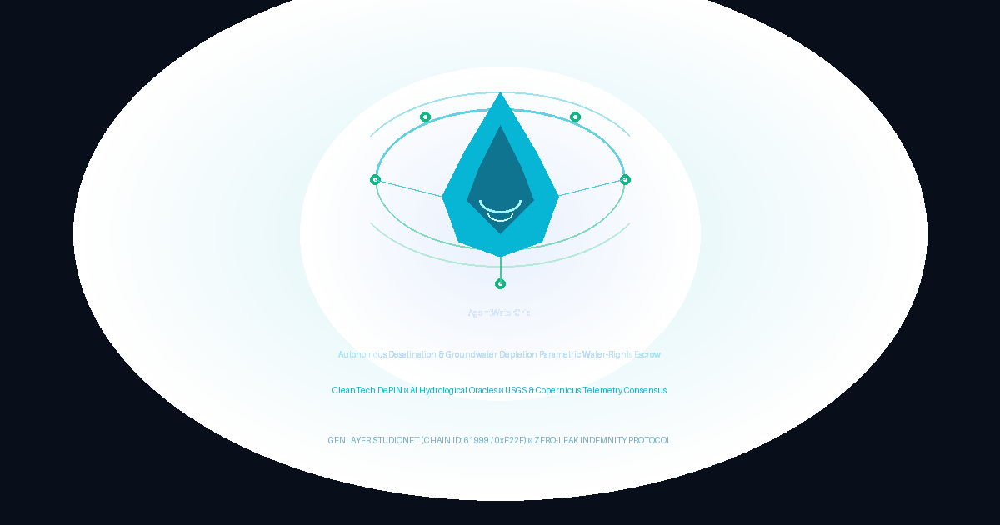

# AgentWaterGrid 💧

**Autonomous Desalination & Groundwater Depletion Parametric Water-Rights Escrow**  
*Powered by GenLayer Intelligent Contracts on StudioNet (Chain ID: `61999` / `0xF22F`)*



---

## 🌊 Overview & Value Proposition

Large agricultural conglomerates and semiconductor fabrication facilities consume massive quantities of groundwater, entering into desalination supply agreements or ecological compensation compacts with local municipal water boards. However, monitoring aquifer drawdown, piezometric head collapse, and Total Dissolved Solids (TDS) salinity intrusion has historically suffered from fragmented reporting, obscured records, and delayed compensation during severe droughts.

Traditional EVM smart contracts cannot inspect unstructured hydrological sensor networks or remote sensing feeds without centralized, corruptible oracles.

**AgentWaterGrid** solves this on **GenLayer**:
1. **Parametric Water-Rights Escrow**: Industrial consumers lock indemnity escrow funds guaranteeing extraction limits (`create_water_license_escrow`).
2. **Real-Time Hydrological Telemetry Ingestion**: When depletion occurs, community representatives file claims bound directly to accredited sensor feeds (USGS NWIS, Copernicus Land Service, NOAA, GRDC) via `trigger_depletion_claim`.
3. **On-Chain AI Hydrology Tribunal**: GenLayer validator nodes autonomously fetch live piezometric telemetry (`gl.nondet.web.render`), analyze mineral salinity (PPM) and aquifer drawdown (cm), and execute multi-party semantic consensus (`gl.vm.run_nondet`).
4. **Parametric Disbursement & Appellate Cooling-Off**: Severe aquifer breaches disburse 100% relief payouts to communities; moderate warnings disburse a 40% penalty; sustainable extraction returns a 100% refund after a 24-block (~72s) challenge window with a 10% staked dispute bond.

---

## 🏛️ Project Explorer Submission Metadata

| Field | Content |
|---|---|
| **Project Name** | **AgentWaterGrid** |
| **Primary Category** | **CleanTech / DePIN Infrastructure** |
| **Category Tag 1** | **Parametric Insurance** |
| **Category Tag 2** | **Environmental Oracles** |
| **One-Liner** | Autonomous groundwater depletion & desalination parametric escrow evaluated by AI on live USGS telemetry. |
| **Description** | AgentWaterGrid is a decentralized water-rights indemnity protocol built on GenLayer. Industrial facilities lock GEN escrow to guarantee sustainable extraction limits. When droughts or saline intrusions occur, community water boards submit accredited USGS or Copernicus piezometer feeds. An on-chain GenLayer AI Tribunal reads the telemetry directly via non-deterministic web rendering and adjudicates aquifer drawdown against policy SLAs, automatically releasing disaster relief grants or returning refunds after an appellate cooling window. |
| **Network** | **GenLayer StudioNet (Chain ID: 61999 / Hex 0xF22F)** |
| **Contract Address** | `0x933a7C4fCa26ECA2AE65F2d4537A68A0D18f7628` |

---

## ⚡ Deployed Intelligent Contract (StudioNet)

- **Network:** GenLayer StudioNet (Chain ID: `61999` / Hex: `0xF22F`)
- **RPC URL:** `https://studio.genlayer.com/api`
- **Intelligent Contract Address:** [`0x933a7C4fCa26ECA2AE65F2d4537A68A0D18f7628`](https://studio.genlayer.com)
- **Deployment Transaction Hash:** `0x4e736ecfee5d9cdbb1315d6d88dc6138de4e2340dc93355d683274ab2098e2a4`
- **Initial Monitored Policy (Live):** Policy #1 — `CENTRAL-VALLEY-AQUIFER-B4` (1.0 GEN Escrow, Tx: `0xca3f955dc63439df48efc6c74e593a84e22f9858b1b70e7e320ec7dd89ffcd20`)

---

## 🔬 Intelligent Contract Architecture

The Intelligent Contract (`contracts/contract.py`) leverages core GenLayer primitives:

- **`gl.nondet.web.render`**: Fetches raw sensor text directly from accredited national/international hydrological authorities.
- **Accredited Domain Enforcement**: Only permits feeds originating from trusted sources:
  - `waterdata.usgs.gov` / `usgs.gov` (USGS National Water Information System)
  - `land.copernicus.eu` / `copernicus.eu` (Copernicus Global Land Service)
  - `water.noaa.gov` (NOAA National Water Prediction Service)
  - `grdc.bafg.de` / `bafg.de` (Global Runoff Data Centre)
  - `environment.data.gov.uk` (UK Environment Agency Hydrology API)
- **Prompt Injection Defense (`CANARY_TOKEN`)**: Strict security canary token (`CANARY_AGENT_WATER_GRID_V1`) protects AI validators from adversarial prompt injection in sensor feeds.
- **Dual-Function Consensus (`gl.vm.run_nondet`)**:
  - `leader_fn`: Ingests telemetry, executes rubric prompt on LLM, and formats JSON payload with extracted drawdown and salinity.
  - `validator_fn`: Enforces consensus on the substantive verdict rather than verbatim prose variance.
- **24-Block (~72s) Challenge Window**: Uncontested settlements must wait for 24 blocks before payout finalization (`finalize_settlement`).
- **Appellate Staking Economics**: Appellants must stake a **10% dispute bond** and bind an accredited supplemental observation feed to appeal (`appeal_verdict` + `adjudicate_appeal`).
- **Pull-Payment Safeguard**: In case of transfer failure, funds are credited to `claimable_balances` and withdrawn via `claim_payout()`.

---

## 📊 Hydrological Decision Matrix

$$\text{Decision} = f(\text{Drawdown}_{\text{cm}}, \text{Salinity}_{\text{PPM}}, \text{SLA}_{\text{max}})$$

1. **Severe Aquifer Depletion Breach**:
   $$\text{Drawdown} \ge \text{SLA}_{\text{max}} \quad \lor \quad \text{Salinity} \ge \text{Salinity}_{\text{max}}$$
   - **Verdict**: `AQUIFER_DEPLETION_CONFIRMED`
   - **Payout**: **100% Indemnity Escrow** disbursed to community beneficiary.
2. **Moderate Aquifer Drawdown Warning**:
   $$\frac{\text{SLA}_{\text{max}}}{2} \le \text{Drawdown} < \text{SLA}_{\text{max}}$$
   - **Verdict**: `PARTIAL_DRAWDOWN_PENALTY`
   - **Payout**: **40% Relief Compensation** to community; **60% Preserved** to enterprise.
3. **Sustainable Extraction / Recharged Table**:
   $$\text{Drawdown} < \frac{\text{SLA}_{\text{max}}}{2} \quad \land \quad \text{Salinity} \le \text{Normal}$$
   - **Verdict**: `AQUIFER_COMPLIANT_CLEAN`
   - **Payout**: **100% Escrow Refunded** to industrial enterprise.

---

## 🧪 Comprehensive Pytest Test Suite

The test suite in `tests/test_agentwatergrid.py` contains 12 unit and integration tests passing in **0.12 seconds**:

```bash
pytest tests/ -v
```

```
tests/test_agentwatergrid.py::test_agentwatergrid_confirmed_aquifer_depletion_relief_payout PASSED
tests/test_agentwatergrid.py::test_agentwatergrid_unaccredited_source_rejected PASSED
tests/test_agentwatergrid.py::test_agentwatergrid_partial_drawdown_penalty PASSED
tests/test_agentwatergrid.py::test_agentwatergrid_compliant_water_table PASSED
tests/test_agentwatergrid.py::test_agentwatergrid_cooling_off_protection PASSED
tests/test_agentwatergrid.py::test_agentwatergrid_appeal_overturn_to_compliant PASSED
tests/test_agentwatergrid.py::test_agentwatergrid_appeal_dismissed_bond_forfeit PASSED
tests/test_agentwatergrid.py::test_agentwatergrid_sensor_fetch_failure_unresolved_state PASSED
tests/test_agentwatergrid.py::test_agentwatergrid_canary_token_defense PASSED
tests/test_agentwatergrid.py::test_agentwatergrid_reclaim_expired_policy PASSED
tests/test_agentwatergrid.py::test_agentwatergrid_pull_payment_claim PASSED
tests/test_agentwatergrid.py::test_agentwatergrid_views_and_stats PASSED

============================= 12 passed in 0.12s ==============================
```

---

## 💻 Tech Stack & Repository Structure

```
AgentWaterGrid/
├── contracts/
│   └── contract.py            # GenLayer Intelligent Contract (py-genlayer)
├── tests/
│   ├── conftest.py            # Test fixtures & GenLayer test mocks
│   └── test_agentwatergrid.py # 12 Pytest test cases
├── scripts/
│   ├── deploy_studionet.py    # Automated StudioNet deployment script
│   ├── test_live_studionet.py # Live on-chain interaction & escrow tester
│   └── generate_logo.py       # High-res social banner generator
├── frontend/                  # React 18 + Vite + TS + TailwindCSS dApp
│   ├── package.json
│   ├── vite.config.ts
│   ├── tailwind.config.js
│   ├── src/
│   │   ├── config/genlayer.ts # StudioNet RPC, ABI encoder & tx waiter
│   │   ├── components/
│   │   │   ├── Navbar.tsx
│   │   │   ├── StatsOverview.tsx
│   │   │   ├── CreatePolicyModal.tsx
│   │   │   ├── PolicyCard.tsx
│   │   │   ├── TriggerClaimModal.tsx
│   │   │   ├── HydroInspectorModal.tsx
│   │   │   ├── AppealModal.tsx
│   │   │   └── PullPayoutButton.tsx
│   │   └── utils/formatters.ts
│   └── .env
├── ARCHITECTURE.md            # In-depth architectural blueprint
├── SECURITY.md                # Threat model & prompt injection defenses
├── CHANGELOG.md               # Version changelog
├── LICENSE                    # MIT License
├── deployment.json            # On-chain StudioNet deployment receipt
└── logo.png                   # High-res preview banner
```

---

## 🚀 Getting Started

### 1. Prerequisites
- Python 3.10+ with `genlayer_py` & `pytest`
- Node.js 18+ and npm

### 2. Run Tests
```bash
pytest tests/
```

### 3. Deploy to StudioNet
```bash
python scripts/deploy_studionet.py
```

### 4. Run Frontend Locally
```bash
cd frontend
npm install
npm run dev
```
Open [http://localhost:3000](http://localhost:3000) in your browser.

---

## 📜 License
Distributed under the MIT License. See `LICENSE` for details.
